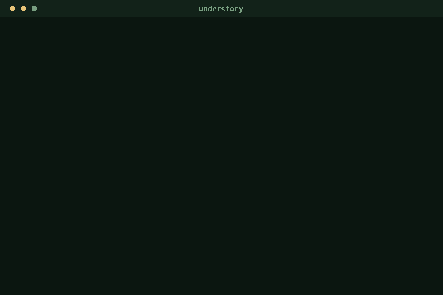

# Understory

Point it at a bird. Keep your phone in your pocket.

Understory listens to a bird, works out what it is with **BirdNET** (open model,
runs on the CPU), and has **Gemma 3** (open weights, served locally by Ollama)
write you a short field note: where to look and what the bird is probably doing.

Everything runs on your machine. **No API key, no account, and no internet** — it
keeps working in a valley with no bars, and the audio never leaves the device. A
`--offline` flag hard-blocks every non-loopback socket so you can watch it refuse
to phone home.



## What the small model is and isn't allowed to say

Asked for plumage, a 1B model invents colours. Asked for a song, it invents calls
(both happened during development). So its job is scoped to the two things it gets
right reliably: **where the bird lives** and **what it is probably doing**. Markings
belong in a field guide, and the card says so. The note is a hint to look, not a
tick on a list.

Want better notes? Swap the model — that is the point of open weights:

```bash
# 1B: ~30-45 s per note on 4 CPU cores. The default.
# 4B: better prose, ~4.5 min per note on the same CPU. Just point at another local Gemma:
ollama create understory-gemma-4b -f Modelfile.4b
.venv/bin/python understory.py listen --seconds 12 --model understory-gemma-4b
```

No code changes, no new API, no key. One local model replaces another.

## Why it exists

Birding is the moment your hands should be free. The screen is the shortest part
of the experience: press one key outdoors, pocket the phone, and the note is
waiting in a markdown log when you get back to the car.

## Quickstart

```bash
./setup.sh                                        # once: python deps + both open models
.venv/bin/python understory.py listen --seconds 12
.venv/bin/python understory.py id recording.m4a --lat 52.52 --lon 13.40
.venv/bin/python understory.py id recording.m4a --offline   # prove it needs no network
.venv/bin/python understory.py notes --last                 # what it heard, off-trail
```

```
Understory  06:41  [offline guard: on]
  Heard: European Robin (99%)
         also Eurasian Blue Tit (60%)

  It is likely foraging for insects in a woodland area. It is probably
  searching for a mate or nesting material.

  (AI field note - a hint to look, not a tick on a list.)

  logged -> ~/.understory/fieldnotes/2026-10-11.md
```

## How it works

```
mic ──► 48 kHz mono WAV ──► BirdNET (TFLite, 6,522 species, CPU) ──► top species
                                                                        │
                             Ollama ──► Gemma 3 1B ──► 70-word field note ┘
                                                                        │
                                          screen (one card) + markdown log
```

| Piece | What it is | Where it runs |
| --- | --- | --- |
| Identification | BirdNET GLOBAL 6K v2.4 (TFLite) | local CPU, ~1-4 s/clip |
| Field note | Gemma 3 1B Q4_K_M | local, Ollama, ~3 tok/s on 4 old CPU cores |
| Audio I/O | arecord + librosa/soundfile | local |
| Cloud | nothing | — |

`--no-narrate` skips Gemma for a fast identification-only run. If Ollama is not
running, Understory still identifies the bird and tells you how to start Gemma.

## Tests

```bash
.venv/bin/python tests/test_understory.py
```

## Licenses

Code: MIT. Models are separate: BirdNET weights are **CC BY-NC-SA 4.0**
(non-commercial); Gemma 3 is under the **Gemma Terms of Use**. See `LICENSE`.
